# Praktikum Flutter

**Nama:** Aris Riswanto  
**NIM:** C2483207002
**Kelas:** PTI5
**Program Studi:** Pendidikan Teknologi Informasi  
**Universitas:** Universitas Muhammadiyah Tasikmalaya (UMTAS)

## Screenshot Aplikasi

### Halaman Beranda

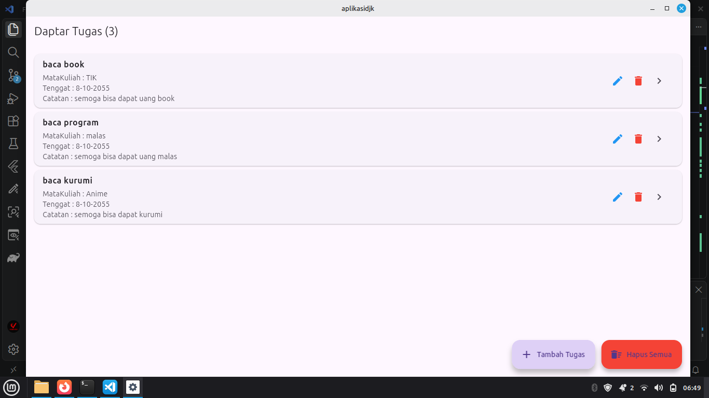

### Halaman Tambah jadwal

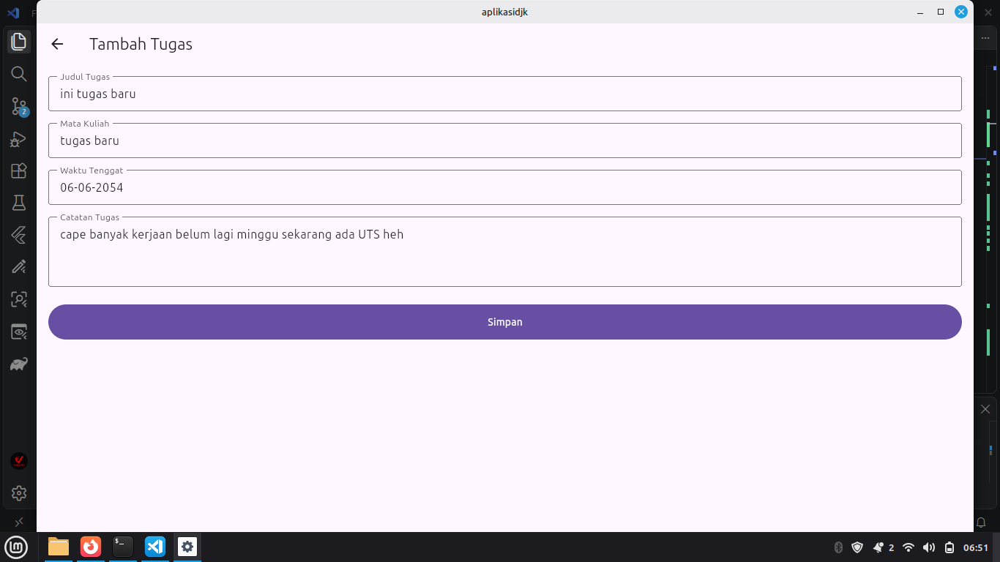

### Halaman Tamabah ketika kita tidak masukan data apa pun kecuali catatan karena bisa kosong isi nya

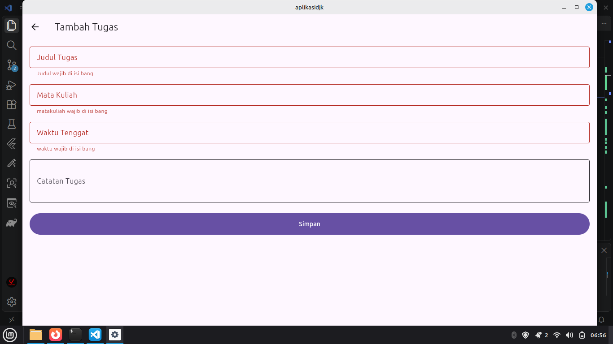

### Halaman setelah Tambah jadwal

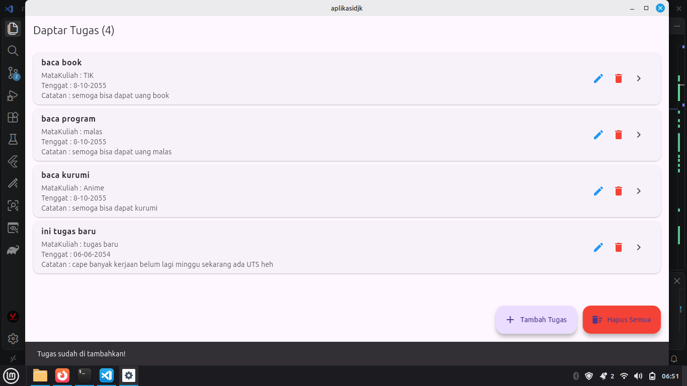

### Halaman setelah kita klik icon edit jadwal

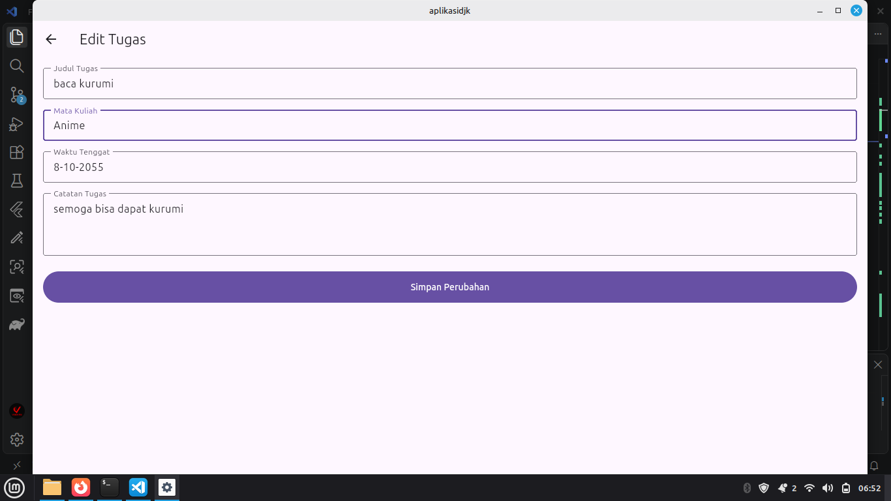

### Halaman Beranda ketika kita tidak jadi edit data nya

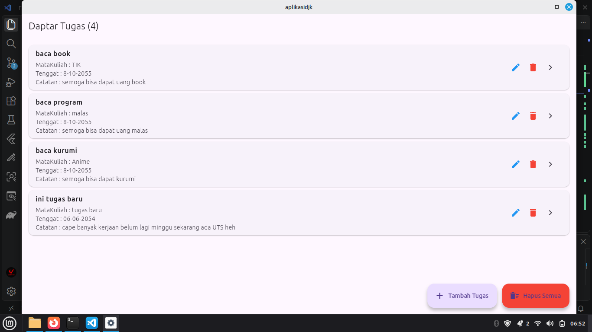

### Halaman Ketika kita melakukan edit dan untuk kolom mata kuliah itu tidak bisa di edit

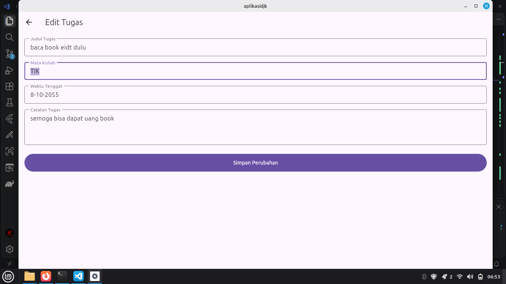

### Halaman setelah kita klik komfirmasi edit jadwal

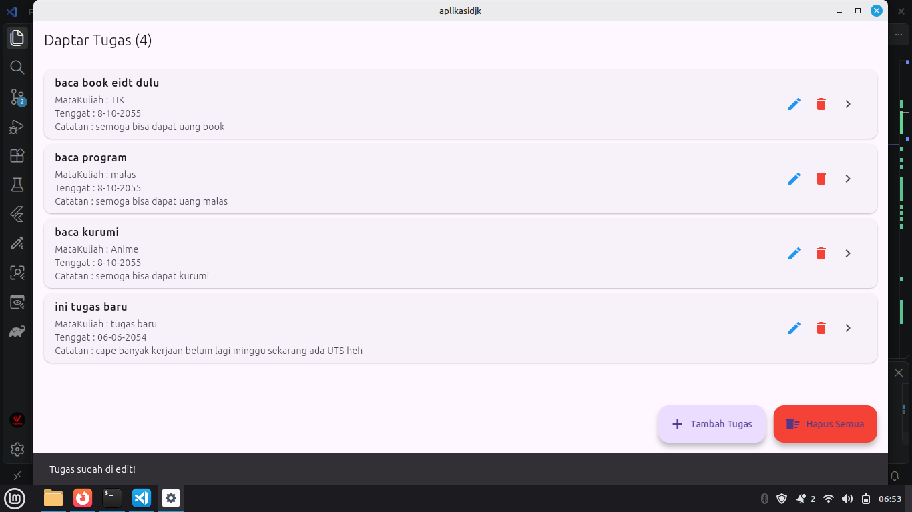

### Halaman edit ketika kita kosongkan kecuali bagian mata kuliah yang tidak bisa di edit dan catatan yang isi nya bisa kosong

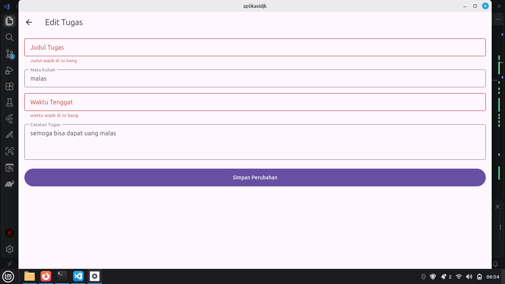

### Halaman setelah kita klik icon delete jadwal

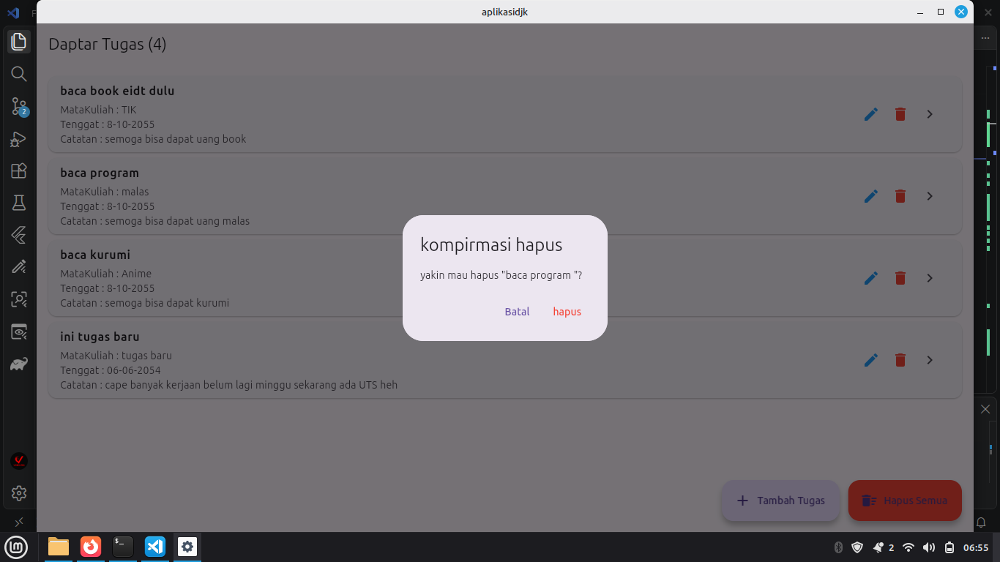

### Halaman setelah kita delete 1 jadwal

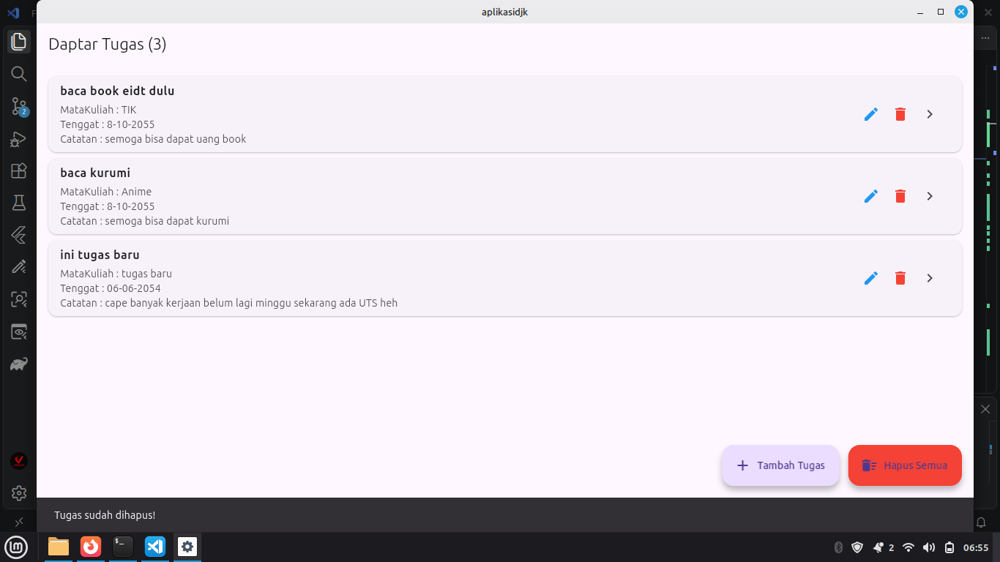

### Halaman detail jadwal

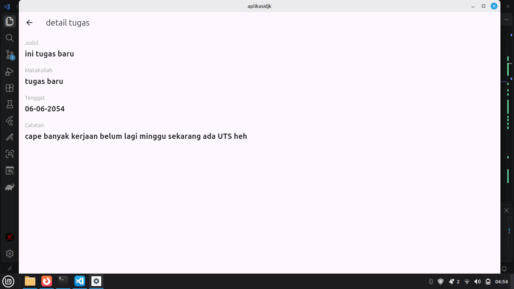

### Halaman setelah kita klik icon delete jadwal semua

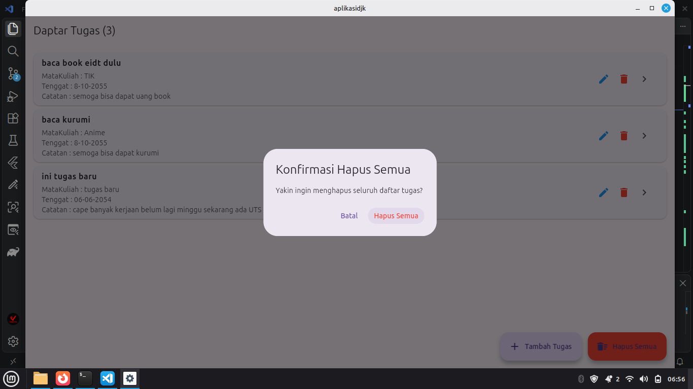

### Halaman setelah kita delete jadwal semua

### Halaman setelah kita klik icon delete jadwal tapi data list nya tidak ada

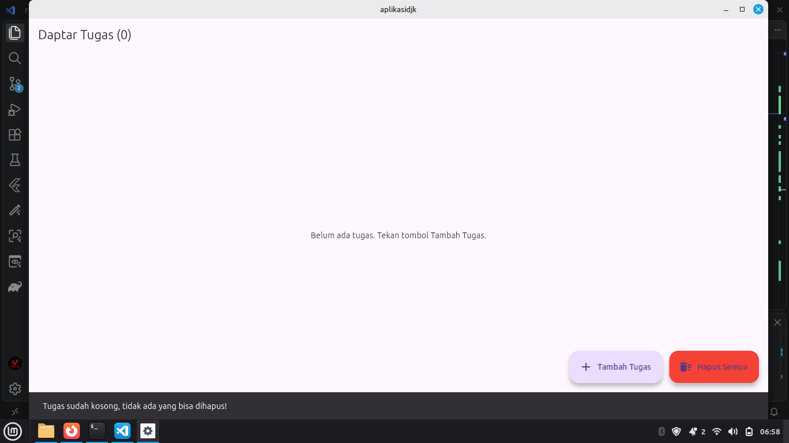
